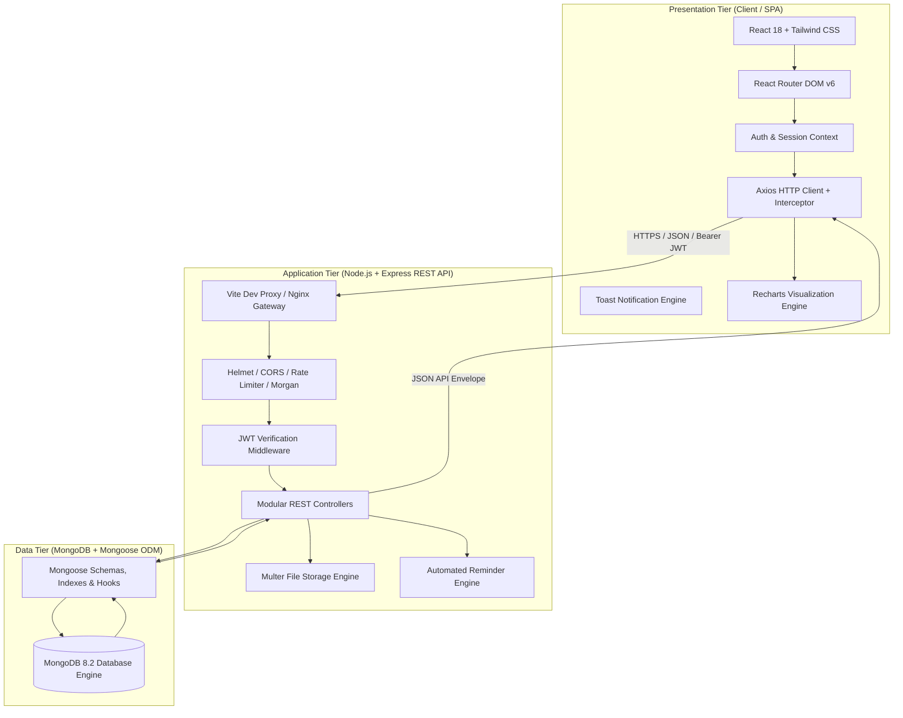

# InternTrack – System Architecture & Technical Design

## 1. Architectural Overview
InternTrack follows a modern 3-tier architecture with a decoupled Single Page Application (SPA) frontend, a stateless RESTful Node.js / Express backend, and a document-oriented MongoDB database.



---

## 2. Frontend Architecture (`client/`)

### 2.1 State & Session Management
- **Stateless Authentication**: Upon login, a JWT token is stored in client `localStorage` and managed globally by `AuthContext`.
- **Axios Interceptor**: Automatically injects `Authorization: Bearer <token>` into the request headers for all API calls. A response interceptor catches `401 Unauthorized` responses and cleans up the session to prompt re-authentication.
- **Toast Notifications**: Built-in `ToastContext` delivers non-blocking feedback across success, warning, error, and informational states.

### 2.2 Component Hierarchy & Layout
- **Root Layout (`DashboardLayout`)**:
  - Persistent, responsive Sidebar with active stage indicators and mobile hamburger toggle.
  - Sticky Top Navbar with real-time `NotificationBell`, quick-action buttons, and user avatar.
  - Responsive main outlet container.
- **Common Component Library**:
  - `Button`: Primary, secondary, outline, danger, ghost, loading spinner.
  - `Badge`: Status color-coded indicators for pipeline stages and work modes.
  - `Modal`: Accessible dialog with focus trap and escape listener.
  - `ConfirmDialog`: Action safeguard for destructive operations.
  - `Skeleton`: Content placeholder screens for tables and cards.
  - `EmptyState`: Actionable fallbacks when lists are empty.

---

## 3. Backend Architecture (`server/`)

### 3.1 Controller-Service-Repository Pattern
- **Routes Layer (`routes/`)**: Declares REST endpoints, attaches route-specific middleware (`protect`, `authLimiter`, `upload`).
- **Controllers Layer (`controllers/`)**: Handles request extraction, validation, business logic execution, and uniform JSON response serialization.
- **Models Layer (`models/`)**: Mongoose models defining schema structures, default values, validators, and indexing strategies.
- **Centralized Error Handling (`middleware/errorHandler.js`)**: Converts Mongoose `CastError`, duplicate keys (`11000`), validation errors, and JWT expiration into uniform HTTP responses:
```json
{
  "success": false,
  "message": "Descriptive, user-friendly error message"
}
```

---

## 4. Security Architecture
1. **Password Protection**: Passwords are never stored in plaintext. Mongoose `pre('save')` hooks hash passwords using `bcryptjs` with 10 salt rounds. Passwords are excluded from queries by default (`select: false`).
2. **Stateless Tokens**: Signed using `HS256` HMAC with an environment-specified secret key and 7-day expiration.
3. **HTTP Protection**: `helmet` sets HTTP headers (`X-Frame-Options`, `X-Content-Type-Options`, `X-XSS-Protection`).
4. **CORS Hardening**: Strict origin whitelisting (`CLIENT_URL`).
5. **Rate Limiting**: Authentication endpoints are rate-limited (`express-rate-limit`) to 30 requests per 15-minute window per IP.
6. **File Upload Security**:
   - Multer disk storage writes files to an isolated directory (`server/uploads/resumes/`).
   - Strict MIME type checks (`application/pdf`, `application/msword`, `application/vnd.openxmlformats-officedocument.wordprocessingml.document`).
   - File size ceiling enforced at 5MB.
   - Sanitized filenames prevent directory traversal exploits.

