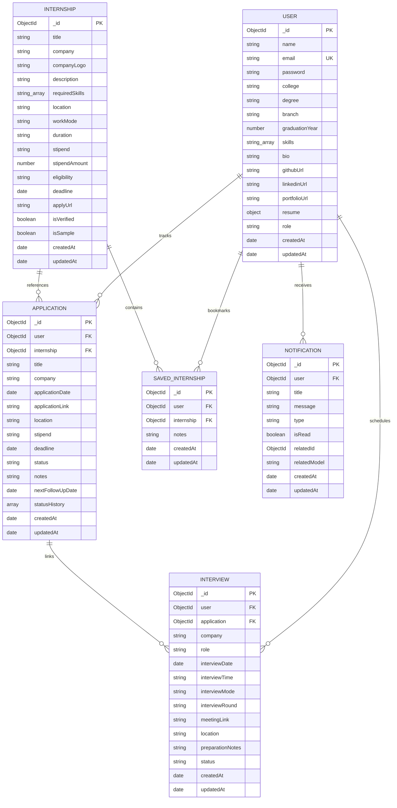

# InternTrack – Database Design & Schema Specification

## 1. Entity-Relationship Overview

---

## 2. Collection Schemas & Data Dictionary

### 2.1 `users` Collection
Stores student profile, credentials, academic details, and resume metadata.

| Field | Type | Required | Description / Constraints |
| :--- | :--- | :--- | :--- |
| `_id` | ObjectId | Yes | Unique Primary Key |
| `name` | String | Yes | Student Full Name (max 60 chars) |
| `email` | String | Yes | Unique, lowercase email address |
| `password` | String | Yes | Bcrypt-hashed password (hidden by default) |
| `college` | String | Yes | University or Institution name |
| `degree` | String | Yes | Degree name (e.g. B.S., B.Tech, M.S.) |
| `branch` | String | Yes | Academic branch / major |
| `graduationYear`| Number | Yes | Expected graduation year (2000-2035) |
| `skills` | Array[String]| No | Technical skills indexed for queries |
| `bio` | String | No | Professional bio / statement (max 500 chars) |
| `githubUrl` | String | No | GitHub profile URL |
| `linkedinUrl` | String | No | LinkedIn profile URL |
| `portfolioUrl` | String | No | Personal website / portfolio URL |
| `resume` | Object | No | `{ filename, originalName, path, size, uploadedAt }` |
| `role` | String | Yes | `['student', 'admin']`, default: `'student'` |

---

### 2.2 `internships` Collection
Stores discovered internship listings.

| Field | Type | Required | Description |
| :--- | :--- | :--- | :--- |
| `_id` | ObjectId | Yes | Unique Primary Key |
| `title` | String | Yes | Internship job title (Indexed) |
| `company` | String | Yes | Organization name (Indexed) |
| `companyLogo` | String | No | Logo image URL or placeholder |
| `description` | String | Yes | Full opportunity description |
| `requiredSkills`| Array[String]| No | Indexed skill tags |
| `location` | String | Yes | City, State or Region |
| `workMode` | String | Yes | `['Remote', 'Hybrid', 'On-site']` |
| `duration` | String | Yes | Term duration (e.g. "12 Weeks") |
| `stipend` | String | Yes | Formatted compensation (e.g. "$8,500/mo") |
| `stipendAmount` | Number | No | Numerical stipend for range filtering |
| `eligibility` | String | Yes | Academic criteria & eligibility requirements |
| `deadline` | Date | Yes | Application deadline (Indexed) |
| `applyUrl` | String | Yes | External application link |
| `isVerified` | Boolean | Yes | Verified status badge |
| `isSample` | Boolean | Yes | Sample demonstration role badge |

---

### 2.3 `applications` Collection
Stores student-specific job applications.

| Field | Type | Required | Description |
| :--- | :--- | :--- | :--- |
| `_id` | ObjectId | Yes | Unique Primary Key |
| `user` | ObjectId | Yes | Ref: `User` (Indexed) |
| `internship` | ObjectId | No | Ref: `Internship` (Optional) |
| `title` | String | Yes | Role applied for |
| `company` | String | Yes | Company applied to |
| `applicationDate`| Date | Yes | Date submitted (Default: now) |
| `applicationLink`| String | No | Submission URL |
| `location` | String | No | Role location |
| `stipend` | String | No | Offered / expected compensation |
| `deadline` | Date | No | Deadline date (Indexed) |
| `status` | String | Yes | Enum: `Interested`, `Applied`, `Assessment`, `Shortlisted`, `Interview`, `Selected`, `Rejected`, `Withdrawn` |
| `notes` | String | No | User notes |
| `nextFollowUpDate`| Date | No | Follow-up alert date |
| `statusHistory` | Array[Subdoc]| Yes | `[{ status, changedAt, note }]` |

---

### 2.4 `savedinternships` Collection
Stores bookmarked opportunities.

| Field | Type | Required | Description |
| :--- | :--- | :--- | :--- |
| `_id` | ObjectId | Yes | Unique Primary Key |
| `user` | ObjectId | Yes | Ref: `User` (Indexed) |
| `internship` | ObjectId | Yes | Ref: `Internship` (Indexed) |
| `notes` | String | No | Bookmark memo |

**Unique Compound Index**: `{ user: 1, internship: 1 }` guarantees that students cannot duplicate saved bookmarks.

---

### 2.5 `interviews` Collection
Stores scheduled interview rounds.

| Field | Type | Required | Description |
| :--- | :--- | :--- | :--- |
| `_id` | ObjectId | Yes | Unique Primary Key |
| `user` | ObjectId | Yes | Ref: `User` (Indexed) |
| `application` | ObjectId | No | Ref: `Application` |
| `company` | String | Yes | Company name |
| `role` | String | Yes | Target role |
| `interviewDate`| Date | Yes | Date of interview (Indexed) |
| `interviewTime`| String | Yes | 24-hr time string (e.g. "14:00") |
| `interviewMode`| String | Yes | `['Google Meet', 'Zoom', 'MS Teams', 'In-Person', 'Phone']` |
| `interviewRound`| String | Yes | `['Screening', 'Technical Round 1', 'Technical Round 2', 'System Design', 'Managerial', 'HR / Final']` |
| `meetingLink` | String | No | Video URL |
| `location` | String | No | Room / physical address |
| `preparationNotes`| String| No | Prep notes |
| `status` | String | Yes | `['Scheduled', 'Completed', 'Cancelled', 'Rescheduled']` |

---

### 2.6 `notifications` Collection
Stores in-app reminders and milestone notices.

| Field | Type | Required | Description |
| :--- | :--- | :--- | :--- |
| `_id` | ObjectId | Yes | Unique Primary Key |
| `user` | ObjectId | Yes | Ref: `User` (Indexed) |
| `title` | String | Yes | Notification heading |
| `message` | String | Yes | Notification details |
| `type` | String | Yes | `['deadline', 'interview', 'follow_up', 'status_update', 'system']` |
| `isRead` | Boolean | Yes | Unread tracking flag (Default: `false`) |
| `relatedId` | ObjectId | No | Linked document id |
| `relatedModel` | String | No | Model name (`Application`, `Interview`) |

---

## 3. Indexing Strategy
- `User`: `{ email: 1 }` (Unique)
- `Internship`: Text index on `{ title: 'text', company: 'text', description: 'text', location: 'text' }`
- `Application`: Compound index `{ user: 1, status: 1 }`, `{ user: 1, applicationDate: -1 }`, `{ user: 1, deadline: 1 }`
- `SavedInternship`: Compound unique index `{ user: 1, internship: 1 }`
- `Interview`: `{ user: 1, interviewDate: 1 }`
- `Notification`: Compound index `{ user: 1, isRead: 1, createdAt: -1 }`

